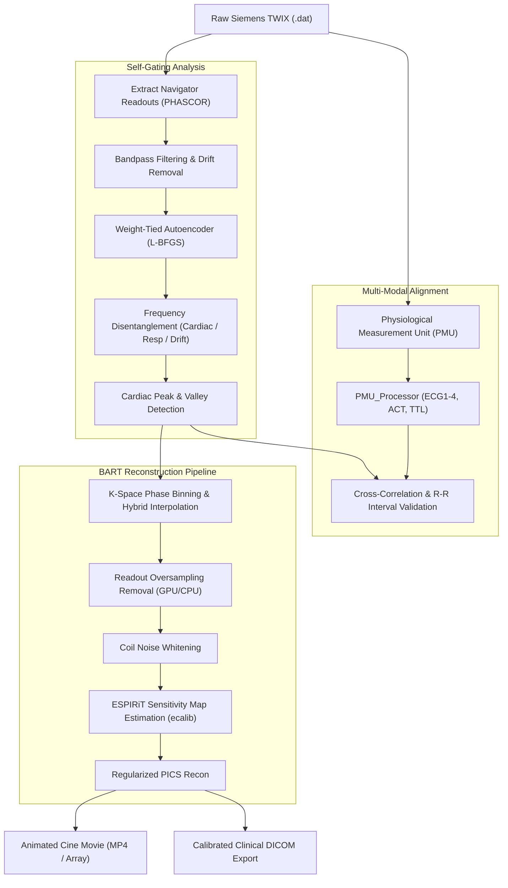

# AutoGate: Self-Gating Reconstruction Pipeline for Cardiac MRI

[](https://www.python.org/)
[](https://developer.nvidia.com/cuda-toolkit)
[](https://pytorch.org/)
[](https://mrirecon.github.io/bart/)
[](https://opensource.org/licenses/Apache-2.0)

**AutoGate** is a self-gating and image reconstruction framework for **Cardiac Magnetic Resonance (CMR)** imaging. It extracts physiological motion dynamics directly from intrinsic MR navigator readouts, eliminating the strict requirement for external electrocardiogram (ECG) leads or acoustic cardiac triggering (ACT) sensors during cine acquisitions.

By integrating custom Siemens pulse sequences, frequency-constrained neural autoencoders, multi-channel physiological measurement unit (PMU) cross-validation, and reconstruction via **BART**, AutoGate provides a robust end-to-end pipeline from raw `.dat` scanner files to clinical-grade DICOM cine series.

---

## Key Features

- **Intrinsic Navigator Acquisition**: Seamlessly integrates with customized Siemens GRE (`a_gre`), bSSFP (`trufi`), and Cardiovascular Cine (`CV`) pulse sequences using ultra-short ADC readouts tagged with the `PHASCOR` flag in the Measurement Data Header (MDH).
- **Frequency-Constrained Autoencoders**: Employs weight-tied Autoencoders (AE) and Variational Autoencoders (VAE) with Fourier-domain bandpass constraints or spectral overlap penalties to disentangle baseline drift (<0.1 Hz), respiration (0.1–0.7 Hz), cardiac motion (0.7–2.0 Hz), and high-frequency harmonics (>2.0 Hz).
- **Fast & Deterministic Optimization**: Utilizes second-order L-BFGS optimization with strong Wolfe line-search conditions, converging in 10–30 epochs (<1 second) with deterministic gating points.
- **Siemens PMU Cross-Validation**: Native parser for Siemens Physiological Measurement Unit (PMU) logs (VE12U platform), validating self-gated triggers against hardware `ECG1`–`ECG4` and `EXT1` (Acoustic Cardiac Triggering / ACT) channels at 400Hz(PMU saving rates).
- **Robust K-Space Binning & Interpolation**: Maps acquired k-space lines into discrete or continuously interpolated cardiac phases (e.g., 30 cardiac phases) with asymmetric echo and oversampling support.
- **BART-Powered Parallel Imaging **: Supports coil noise whitening, readout oversampling removal, ESPIRiT sensitivity map estimation, and $L_2$-regularized PICS reconstruction.
- **Clinical DICOM Export**: Converts 3D cine arrays back into calibrated DICOM series, computing `RescaleSlope`, `RescaleIntercept`, and window centers/widths to match clinical PACS viewers.
- **Containerized Environment**: Includes a turnkey `.devcontainer` with Ubuntu 24.04, CUDA 12.9, GPU-accelerated BART compiled from source, and Python 3.13.

---

## Pipeline Overview



---

## Repository Structure

```text
Autogate/
├── .devcontainer/
│   ├── devcontainer.json         # VS Code dev container configuration
│   └── Dockerfile                # Ubuntu 24.04 + CUDA 12.9 + BART + Python 3.13 setup
├── .gitignore                    # Python, compiled files, and build artifact exclusions
├── LICENSE                       # Apache License 2.0
├── requirements.txt              # Core scientific, deep learning, and MRI dependencies
├── A02_A049_0_slice4.ipynb       # Interactive tutorial notebook (complete slice reconstruction)
└── utils/
    ├── bin.py                    # TWIX I/O, navigator extraction, k-space binning, and BART wrappers
    ├── gating.py                 # Weight-tied AE/VAE with Fourier frequency-windowed constraints
    ├── gating_spectral.py        # Autoencoders with spectral overlap penalty loss (L_overlap)
    ├── gating_old.py             # Legacy baseline implementations for gating benchmarks
    ├── breath_hold_cine.py       # Batch pipeline for breath-hold cine MR reconstruction
    ├── free_breath_cine.py       # Batch pipeline for free-breathing cine MR reconstruction
    └── create_dicom.py           # NumPy array to calibrated DICOM exporter using template headers
```

### Detailed Module Descriptions

| File / Module | Core Functionality |
| :--- | :--- |
| [`utils/bin.py`](file:///d:/Autogate/utils/bin.py) | **Low-level I/O & Signal Utilities**: Reads Siemens TWIX files (`read_path`), extracts navigator readouts (`extract_nav_tr`, `extract_nav_tr_cv`), applies zero-phase IIR filtering (`process_nav_signal`), bins and interpolates k-space (`fill_kspace_interpolate`, `fill_kspace_bin`, `fill_kspace_softbin`), crops readout oversampling (`eliminate_oversampling_gpu`), performs coil noise whitening, runs ESPIRiT (`get_sensitivity`), and parses PMU records via `PMU_Processor`. |
| [`utils/gating.py`](file:///d:/Autogate/utils/gating.py) | **Neural Self-Gating Architectures**: Implements `WeightTiedAutoencoder` and `WeightTiedVAE` with dynamic Fourier masks that enforce hard frequency bands on latent units (Drift: 0–0.1 Hz, Respiration: 0.1–0.7 Hz, Cardiac: 0.7–2.0 Hz, Harmonics: 2.0–10.0 Hz). Includes L-BFGS training loop (`run_training`), peak/valley detector (`find_gating_index`), and R-R interval analysis. |
| [`utils/gating_spectral.py`](file:///d:/Autogate/utils/gating_spectral.py) | **Spectral Disentanglement Autoencoder**: Implements `WeightTiedAutoencoder` with `ae_loss_spectral`, which combines $L_2$ reconstruction loss with a spectral overlap penalty ($\lambda_{\text{overlap}} \cdot \mathcal{L}_{\text{overlap}}$) computed directly across normalized latent frequency spectra. |
| [`utils/breath_hold_cine.py`](file:///d:/Autogate/utils/breath_hold_cine.py) | **Automated Breath-Hold Pipeline**: Provides `run_slice` and `process_BH_folder` to automatically process single slices or directories of breath-hold raw `.dat` files into reconstructed cine arrays and videos. |
| [`utils/free_breath_cine.py`](file:///d:/Autogate/utils/free_breath_cine.py) | **Automated Free-Breathing Pipeline**: Provides `run_slice_FB` and `process_FB_folder` to reconstruct free-breathing acquisitions, isolating both respiratory and cardiac cycles simultaneously using soft binning (`fill_kspace_softbin`). |
| [`utils/create_dicom.py`](file:///d:/Autogate/utils/create_dicom.py) | **DICOM Exporter**: Implements `numpy_to_dicom` and `process_dicom_batch`. Translates floating-point BART reconstruction volumes into 16-bit signed integer DICOM files with calibrated `RescaleSlope`, `RescaleIntercept`, `WindowCenter`, and `WindowWidth`. |

---

## Detailed Walkthrough: `A02_A049_0_slice4.ipynb`

The tutorial notebook [`A02_A049_0_slice4.ipynb`](file:///d:/Autogate/A02_A049_0_slice4.ipynb) demonstrates the end-to-end self-gating reconstruction workflow on a porcine cardiovascular cine slice (`meas_MID00146_FID00205_CV_SG_BreathHold_slc_4.dat`).

### Step 1: Pulse Sequence and Raw Data Extraction
The pulse sequence is a customized Siemens Cardiovascular Cine (CV) sequence running on the VE12U platform. Prior to each slice-refocusing gradient, an ultra-short ADC readout (10 samples, $2\times$ oversampled) is executed to sample the FID center.
- In the Siemens MDH header, these readouts are flagged with `PHASCOR`.
- The `ONLINE` flag is cleared to prevent host reconstruction interference.
- The raw data is parsed using `twixtools`:
  ```python
  from utils.bin import read_path, extract_nav_tr_cv
  twix = read_path(data_dir)
  nav_signal, TR, beginning_timestamp = extract_nav_tr_cv(twix)
  ```

### Step 2: Signal Preprocessing and Drift Filtering
During breath-hold scans, subtle movement or ventilator drift can introduce slow baseline trends ($<0.1$ Hz). Additionally, physical coil contact pins may introduce intermittent electrical spikes.
- `process_nav_signal` pads the signal and applies a zero-phase high-pass/bandpass IIR filter ($f_s = 1/\text{TR}$).
- The neural network is designed to remain highly robust against non-physiological spikes.
  ```python
  from utils.bin import process_nav_signal
  nav_signal_tensor = process_nav_signal(nav_signal, fs=1/TR, free_breath=False, plot=True)
  ```

### Step 3: Dimensionality Reduction via Weight-Tied Autoencoders
The multi-coil navigator signals (e.g., 18 or 30 channels) are compressed into lower-dimensional physiological latent representations:
- **Optimizer**: L-BFGS with Wolfe line-search conditions.
- **Speed**: Converges within 10–30 epochs in approximately 1 second on GPU.
- **Deterministic**: The ratio of temporal points (e.g., 2,414) to parameters (380) ensures high stability across runs.
  ```python
  from utils.gating import run_training
  ae_model = run_training(
      nav_signal_tensor=nav_signal_tensor,
      model_type='ae',
      learning_rate=0.002,
      max_epoch=30,
      hidden_dim1=12,
      hidden_dim2=8,
      sampling_rate=(1/TR)
  )
  ```

### Step 4: Latent Feature Separation & Cardiac Gating Indexing
The latent dimension corresponding to the cardiac band ($0.7 - 2.0$ Hz) is isolated:
- Automatic peak and valley identification extracts individual cardiac trigger timestamps.
  ```python
  from utils.gating import find_gating_index
  cardiac_gating_array, cardiac_peaks, cardiac_valleys = find_gating_index(
      model=ae_model,
      model_type='ae',
      TR=TR,
      nav_signal_tensor=nav_signal_tensor,
      kick_out_num=0,
      plot_all=True,
      order=5,
      bandwidth=0.2,
      include_breath=False
  )
  ```

### Step 5: Siemens PMU Data Parsing & Trigger Cross-Validation
Siemens Physiological Measurement Unit (PMU) logs recorded at 400 Hz (ECG) and 50 Hz (TTL pulses) are extracted to benchmark the self-gating triggers:
- Compares Self-Gating (SG), `ECG1`–`ECG4`, and `EXT1` (Acoustic Cardiac Triggering / ACT).
- Demonstrates physiological timing consistency and quantifies R-R interval jitter.
  ```python
  import twixtools as tt
  from utils.bin import PMU_Processor
  from utils.gating import get_original_indices, plot_gating

  pmu = tt.pmu.PMU(twix[-1]['mdb'])
  pmu_processor = PMU_Processor(pmu, beginning_timestamp=beginning_timestamp)
  pmu_processor.plot_all_channels()

  original_cardiac_gate = get_original_indices(cardiac_gating_array, discard_num=0)
  origin_trigger_ms = pmu_processor.get_origin_trigger_ms("ECG4")
  TTL_first_trigger = pmu_processor.get_TTL_first_trigger()
  self_gating_times_ms = original_cardiac_gate[:-1] * TR * 1000

  plot_gating(self_gating_times_ms, TTL_first_trigger, origin_trigger_ms)
  ```

### Step 6: Cardiac Phase K-Space Binning & Interpolation
Raw k-space readouts are sorted into 30 cardiac phases across the cardiac cycle using hybrid interpolation:
- Corrects for asymmetric echoes and accommodates variable R-R durations.
  ```python
  from utils.bin import fill_kspace_interpolate
  k_space = fill_kspace_interpolate(
      twix=twix,
      gating_array=original_cardiac_gate,
      num_cardiac_phases=30,
      discard_num=0
  )
  ```

### Step 7: Parallel Imaging & Compressed Sensing Reconstruction (BART)
Image reconstruction is executed using the Berkeley Advanced Reconstruction Toolbox (BART):
1. **Oversampling Removal**: `eliminate_oversampling_gpu` removes the $2\times$ readout oversampling.
2. **Noise Whitening**: Measures coil noise statistics from pre-scan noise lines (`get_noise`) and decorrelates coil channels via `bart whiten`.
3. **Sensitivity Map Estimation**: Computes ESPIRiT calibration maps (`cal_size=32`, `kernel_size=6`):
   ```python
   from utils.bin import get_sensitivity, visualize_sens_maps
   sens_maps = get_sensitivity(k_space_whiten, cal_size=32, kernel_size=6, threshold=1e-4, crop_value=0.15, num_maps=2, use_gpu=True)
   ```
4. **PICS Reconstruction**: Runs $L_2$-regularized parallel imaging compressed sensing:
   ```python
   recon = bart(1, f'pics -R Q:{l2_reg} -g -S', k_space_cropped, sens_maps)
   recon_rss = bart(1, 'rss 16', recon)
   ```

### Step 8: Cine Animation
The resulting 30-phase 2D cardiac cine is visualized interactively and saved as a high-frame-rate animation:
```python
from utils.bin import animate_3d_array
animate_3d_array(data=np.abs(recon_rss.squeeze()), interval=100, cmap='gray')
```

---

## Installation & Setup

### Option 1: Docker / VS Code Dev Container (Recommended)

The repository provides a complete development container configuration in `.devcontainer/`:
- **Base**: `nvidia/cuda:12.9.1-cudnn-devel-ubuntu24.04`
- **Compiler & Tools**: GCC, GFortran, FFTW3, OpenBLAS, LAPACKE
- **BART**: Compiled from source with `CUDA=1`, `OPENBLAS=1`, and `PARALLEL=1`
- **Python**: Python 3.13 via Astral `uv`

To use:
1. Open the repository folder in **VS Code**.
2. Click **Reopen in Container** when prompted (or open command palette: `Remote-Containers: Reopen in Container`).
3. All dependencies, environment variables (`TOOLBOX_PATH=/opt/bart`, `PYTHONPATH`), and GPU links will be configured automatically.

### Option 2: Local Environment Setup

If running locally on a system with CUDA and an existing BART installation:

```bash
# 1. Create and activate a virtual environment
python -m venv venv
source venv/bin/activate  # On Windows: .\venv\Scripts\activate

# 2. Install dependencies
pip install -r requirements.txt

# 3. Configure BART environment variables
export TOOLBOX_PATH=/path/to/bart
export PATH=$TOOLBOX_PATH:$PATH
export PYTHONPATH=$TOOLBOX_PATH/python:$PYTHONPATH
```

---

## Batch Processing Usage

### 1. Breath-Hold Cine Batch Reconstruction
```python
from utils.breath_hold_cine import run_slice, process_BH_folder

# Process a single slice raw file
run_slice("path/to/meas_..._CV_SG_BreathHold.dat", save_dir="./output")

# Batch process an entire directory of slices
process_BH_folder("path/to/raw_data_dir", save_dir="./output")
```

### 2. Free-Breathing Cine Batch Reconstruction
```python
from utils.free_breath_cine import run_slice_FB, process_FB_folder

# Process free-breathing raw data with simultaneous respiratory & cardiac binning
run_slice_FB("path/to/meas_..._CV_SG_FreeBreath.dat", save_dir="./output")
```

### 3. Converting Reconstructions to Calibrated DICOMs
```python
from utils.create_dicom import numpy_to_dicom, process_dicom_batch

# Convert a saved .npy volume using metadata from a template scanner DICOM folder
numpy_to_dicom(
    npy_path="./output/array/meas_..._CV_SG.npy",
    dicom_dir="path/to/template_dicom_folder",
    save_dir="./output/dicom"
)
```

---

## Technical Specifications

- **MRI Scanner Compatibility**: Siemens 1.5T / 3T platforms (tested on VE12U, compatible with pre-XA and XA platforms).
- **Supported Pulse Sequences**: Cardiovascular Cine (`CV`), Gradient Echo (`a_gre`), Balanced Steady-State Free Precession (`trufi`).
- **Navigator Signal**: Ultra-short FID center readout (10 samples, $2\times$ oversampled), `PHASCOR` MDH flag.
- **Deep Learning Frameworks**: PyTorch (default notebook / batch pipelines) and JAX (available in `utils/gating.py`).
- **Parallel Imaging Acceleration**: Supports GRAPPA (R=2, 3) and compressed sensing (PICS) via BART.

---

## License

This project is licensed under the **Apache License 2.0**. See the [LICENSE](file:///d:/Autogate/LICENSE) file for details.
